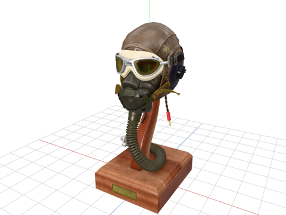
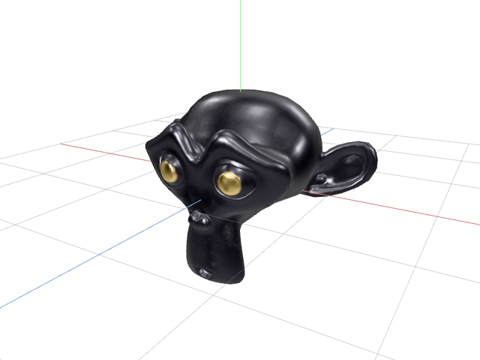
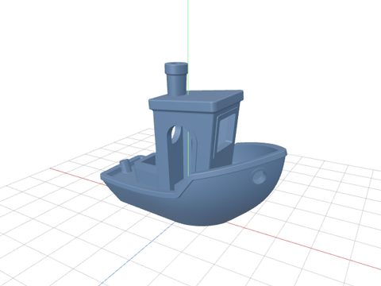
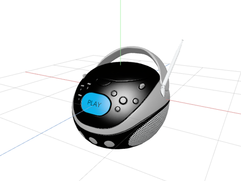
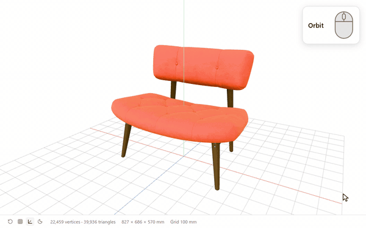
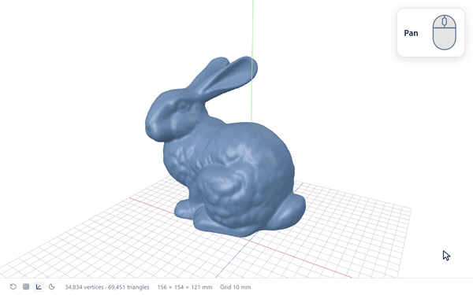
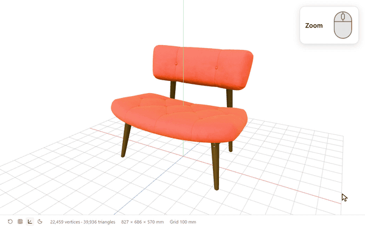
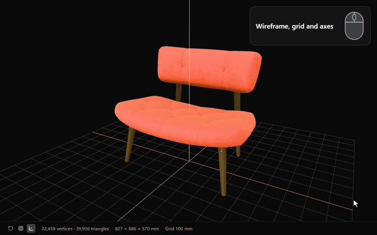
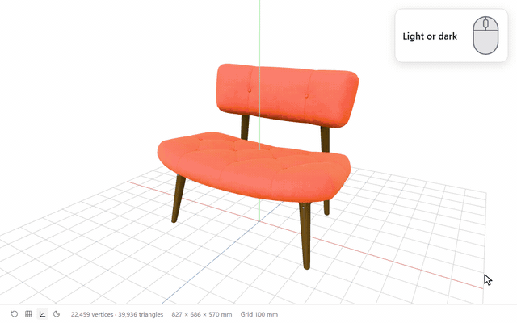
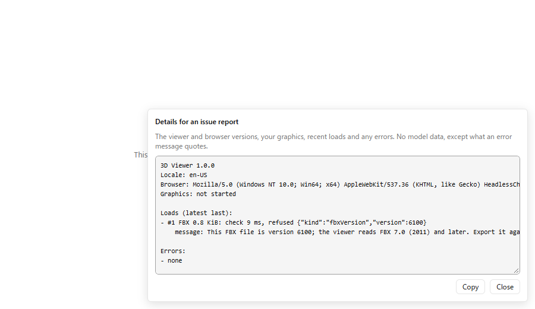

<div align="center">

**English** · [日本語](docs/i18n/README.ja.md) · [Deutsch](docs/i18n/README.de.md) · [Español](docs/i18n/README.es.md) ·
[Français](docs/i18n/README.fr.md) · [한국어](docs/i18n/README.ko.md) · [Português](docs/i18n/README.pt-BR.md) ·
[Русский](docs/i18n/README.ru.md) · [Türkçe](docs/i18n/README.tr.md) · [简体中文](docs/i18n/README.zh-Hans.md) ·
[繁體中文](docs/i18n/README.zh-Hant.md)

# 3D Viewer for Orca

A read-only viewer for [Orca](https://github.com/stablyai/orca) that opens GLB, glTF, STL, PLY, OBJ and FBX files.
Orbit around a model, play its animations, and check at a glance that it is the size you expect.

[](https://github.com/momokun7/orca-3d-viewer/actions/workflows/ci.yml)
[](LICENSE)
[](https://github.com/stablyai/orca)
[](#security)

[Quick start](#quick-start) · [Formats](#formats) · [Features](#features) · [Install](#install) · [Usage](#usage) ·
[Troubleshooting](#troubleshooting) · [Security](#security) · [Development](#development) ·
[Report a bug](https://github.com/momokun7/orca-3d-viewer/issues/new?template=bug_report.yml)


</div>

## Quick start

1. In Orca, open **Settings → Plugins → Install plugin**. On the **Git URL** tab, paste `https://github.com/momokun7/orca-3d-viewer#v1.0.0` into **Repository URL**, choose **Continue**, then **Install**, and then **Enable plugin**.
2. Open a `.glb`, `.gltf`, `.stl`, `.ply`, `.obj` or `.fbx` file.
3. Drag to orbit, and scroll to zoom.

No permissions are required. See [Install](#install) and [Usage](#usage) for more.

## Formats

One viewer for six formats.

<table>
  <tr>
    <td width="33%"></td>
    <td width="33%"></td>
    <td width="33%"></td>
  </tr>
  <tr>
    <td align="center"><b>GLB</b>: A Beautiful Game</td>
    <td align="center"><b>glTF</b>: Corset</td>
    <td align="center"><b>STL</b>: 3DBenchy</td>
  </tr>
  <tr>
    <td width="33%"></td>
    <td width="33%"></td>
    <td width="33%"></td>
  </tr>
  <tr>
    <td align="center"><b>PLY</b>: Stanford Armadillo</td>
    <td align="center"><b>OBJ</b>: Utah Teapot</td>
    <td align="center"><b>FBX</b>: BoomBox</td>
  </tr>
</table>

| Format | Extensions | Colors and textures | Animation | Size unit | Notes |
| --- | --- | --- | --- | --- | --- |
| glTF 2.0 | `.glb` `.gltf` | Yes | Yes | Meters (per the glTF spec) | A `.gltf` must have its data embedded |
| STL | `.stl` | Colors stored in the file, or a default color | No | Millimeters (the 3D printing convention), Z up | Binary and text |
| PLY | `.ply` | Vertex colors, or a default color | No | Shown in meters | Binary and text |
| OBJ | `.obj` | Vertex colors (`.mtl` files are not read) | No | Shown in meters | |
| FBX | `.fbx` | Embedded textures only | Yes | The unit set in the file | Binary FBX 7.0 (2011) and later |

glTF files that use Draco or Meshopt compression, or KTX2 / Basis Universal textures, open too.

## Features

### Look around

<table>
  <tr>
    <td width="50%"></td>
    <td width="50%"></td>
  </tr>
  <tr>
    <td align="center"><b>Orbit</b>: drag</td>
    <td align="center"><b>Pan</b>: right-drag, or <kbd>Shift</kbd> + drag</td>
  </tr>
  <tr>
    <td width="50%"></td>
    <td width="50%"></td>
  </tr>
  <tr>
    <td align="center"><b>Zoom</b>: scroll</td>
    <td align="center"><b>Reset the view</b>: the first toolbar button</td>
  </tr>
</table>

### Real-world size

A floor grid, X / Y / Z axes and the model's width × height × depth make a model authored in the wrong unit
obvious at once. The Stanford Bunny measures 15.6 cm across.


### Wireframe, grid and axes

Show the mesh as a wireframe, or hide the grid and axes. The status bar shows the vertex and triangle counts.



### Animations

Play and pause animations, and choose a clip when the model has more than one.


### Stays current

When you save the file, the view updates to the new version and the camera stays where it was.


### Light or dark

The viewer starts in the light theme, and the moon button in the toolbar switches between light and dark. Your
last theme, wireframe and grid settings are remembered, even after Orca restarts (Orca 1.4.250 and later).



### Eleven languages

The viewer uses the same language as Orca: English, 日本語, Deutsch, Español, Français, 한국어, Português,
Русский, Türkçe, 简体中文 and 繁體中文.

### Details to paste into an issue

The **i** button in the toolbar (or, on an error screen, the **Details** button below the message) opens a
summary of the viewer's version, your browser and graphics hardware, recent loads and how long they took, and
any errors. **Copy** it into an issue to show exactly what happened. It contains no model data, except what an
error message quotes.



## Install

1. In Orca, open **Settings → Plugins** and choose **Install plugin**.
2. On the **Git URL** tab, paste this into **Repository URL**:

   ```text
   https://github.com/momokun7/orca-3d-viewer#v1.0.0
   ```

3. Choose **Continue**, then **Install**. In the dialog that follows, choose **Enable plugin**; nothing runs until
   you do. The viewer asks for no permissions.

> [!IMPORTANT]
> Requires the Orca desktop app, version 1.4.248 or later.

## Usage

Open a file in any of these formats to view it in 3D. Because `.gltf` and `.obj` are text files, the editor tab
lets you switch between **Source** (the text) and **3D**.

| Action | How |
| --- | --- |
| Orbit | Drag |
| Pan | Right-drag, <kbd>Shift</kbd> + drag, or the arrow keys |
| Zoom | Scroll |
| Reset the view | The first toolbar button |
| Wireframe, grid and axes | The buttons next to it |
| Light or dark | The moon button |
| Details | The **i** button |
| Animations | The play button and the clip menu (when the model has animations) |

## Limits

> [!NOTE]
> Orca plugins can read only the open file, not other files in the same folder, so data stored in separate
> files cannot be shown. A `.gltf` whose geometry is in a separate `.bin` file will not open, and textures in
> separate image files and an OBJ's `.mtl` are ignored. A `.glb`, a `.gltf` with embedded data, or an FBX with
> embedded textures shows everything.

- **Desktop app only.** When Orca runs in a browser, the file opens in Source view.
- **Up to 64 MiB**, Orca's limit for custom editors. A model that would decode to far more data than is safe
  to hold in memory, or that uses a feature the viewer cannot read, is refused with a message explaining why.
- **No older or text FBX files.** Export them again as binary FBX 7.0 or later.

All 152 GLB and embedded glTF models in the Khronos
[glTF Sample Assets](https://github.com/KhronosGroup/glTF-Sample-Assets) have been tested. All of them open
except three, which need an extension that three.js does not implement.

## Troubleshooting

<details>
<summary>The file opens as text instead of 3D</summary>

`.gltf` and `.obj` are text files, so they may open in Source view. Choose **3D** on the editor tab. When Orca
runs in a browser, 3D view is not available.

</details>

<details>
<summary>Textures or colors are missing</summary>

Plugins cannot read textures stored in separate image files; the status bar lists the files that could not be
read. For glTF, use a `.glb`; for FBX, export with the textures embedded. An OBJ's `.mtl` cannot be read either,
so the model is shown in its vertex colors if it has them, or in a default color if not.

</details>

<details>
<summary>The size looks wrong</summary>

STL, PLY and OBJ files do not store a unit, so STL is shown in millimeters and PLY and OBJ in meters. FBX and
glTF use the unit set in the file. If the size is off by a factor of 100 or 1000, check which unit the model was
exported in.

</details>

<details>
<summary>It says the model cannot be opened</summary>

The message explains why. Models that are too large, corrupt files, and models that use features the viewer
does not support are refused before they are opened. If the reason is unclear, paste the **Details** into an
issue.

</details>

<details>
<summary>Reporting a bug</summary>

Use the [bug report](https://github.com/momokun7/orca-3d-viewer/issues/new?template=bug_report.yml) template
and paste the **Details** text. If you can share the model, say where it came from. Report security problems
in a [private report](https://github.com/momokun7/orca-3d-viewer/security/advisories/new), not in an issue.

</details>

## Security

Models are untrusted input, so the viewer is built to offer as little attack surface as possible.

- **Isolated**: it runs in Orca's isolated plugin frame under a strict Content-Security-Policy, with no network
  access.
- **No permissions**: the manifest requests no capabilities (no worker, no commands, no file access).
- **Read-only**: it never edits or saves the document, and URIs inside a model are never passed to a loader.
- **Checked first**: files in every format are checked against size budgets on a separate thread before
  anything is decoded. Compressed FBX arrays are inflated in small steps, and inflation stops as soon as an
  array exceeds its declared size.
- **Tested**: CI runs the viewer under Orca's frame policy against hostile and fuzzed models, and verifies that
  the committed bundle can be reproduced from source.

See [SECURITY.md](SECURITY.md) for details.

## Development

The plugin's source code is in `build/src`. `build/build.mjs` bundles it into `editor/`, which is committed so
that Orca can load the plugin without a build step.

```sh
cd build
npm ci
npm test
npm run typecheck
npm run build
```

With [mise](https://mise.jdx.dev), `mise run check` runs the same checks as CI, and `mise tasks` lists the
other tasks.

To try your changes in Orca, run `orca plugin dev watch .` from the repository root, or add the folder under
**Settings → Plugins → Development**.

## Contributing

[CONTRIBUTING.md](CONTRIBUTING.md) describes how issues, labels, the project board, milestones and pull
requests are used. Translations other than English and Japanese were machine-drafted, so corrections from
native speakers are very welcome.

## License and credits

[MIT](LICENSE). The bundled three.js, meshoptimizer, fflate and Lucide (MIT / ISC) and the Draco decoder
(Apache-2.0) keep their own licenses; see [THIRD_PARTY_NOTICES.txt](THIRD_PARTY_NOTICES.txt).

The models shown in the images and GIFs come from the sources below. In every copy, the format conversion, the
colors and the orientation are our own changes (for 3DBenchy, the Armadillo and the Teapot, we wrote the colors
into the files ourselves).

| Model | Used in | Source | License |
| --- | --- | --- | --- |
| Stanford Bunny | Hero image, feature GIFs | [Stanford 3D Scanning Repository](https://graphics.stanford.edu/data/3Dscanrep/). Source: Stanford University Computer Graphics Laboratory | Free for non-commercial use with credit |
| Stanford Armadillo | PLY | As above | As above |
| A Beautiful Game | GLB | Khronos [glTF Sample Assets](https://github.com/KhronosGroup/glTF-Sample-Assets). Original model by the MaterialX Project, conversion to glTF by Ed Mackey | [CC BY 4.0](https://creativecommons.org/licenses/by/4.0/) |
| Corset | glTF | Khronos glTF Sample Assets, Microsoft | [CC0 1.0](https://creativecommons.org/publicdomain/zero/1.0/) |
| BoomBox | FBX | Khronos glTF Sample Assets, Microsoft | CC0 1.0 |
| 3DBenchy | STL | [3DBenchy.com](https://www.3dbenchy.com/), Creative Tools | CC0 1.0 |
| Utah Teapot | OBJ | [McGuire Computer Graphics Archive](https://casual-effects.com/data), Martin Newell (1975), Kenzie Lamar | CC0 |
| Fox | Animation GIF | Khronos glTF Sample Assets. Model by PixelMannen (CC0 1.0), rigging and animation by tomkranis, conversion to glTF by @AsoboStudio and @scurest | [CC BY 4.0](https://creativecommons.org/licenses/by/4.0/) |
