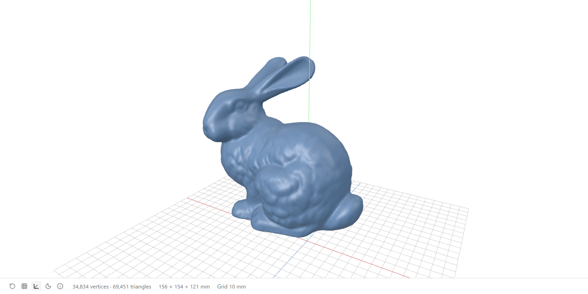
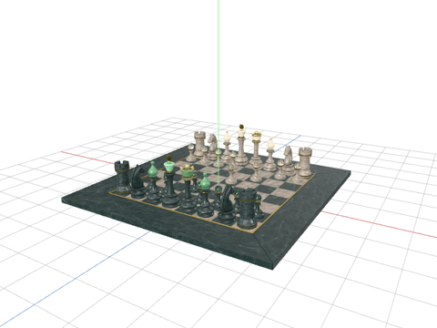
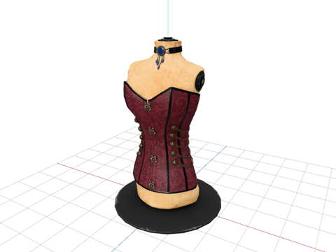
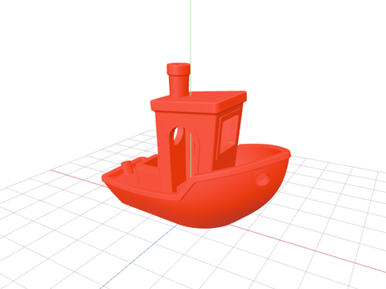
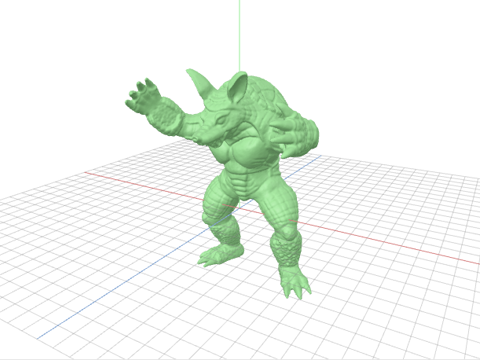
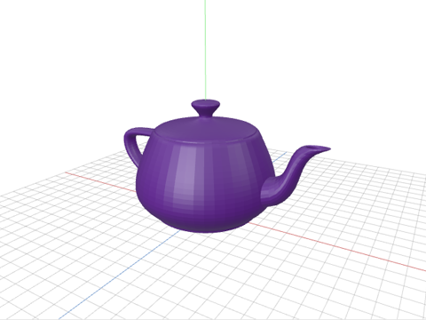
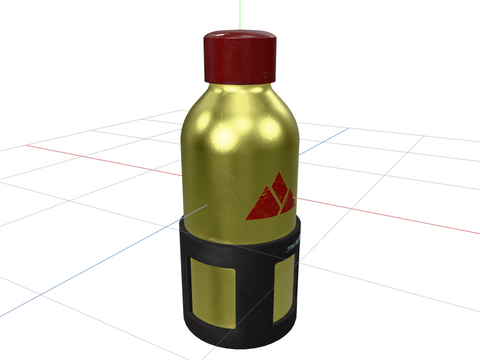
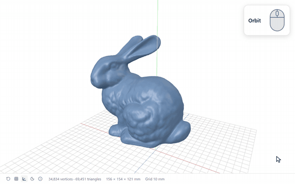
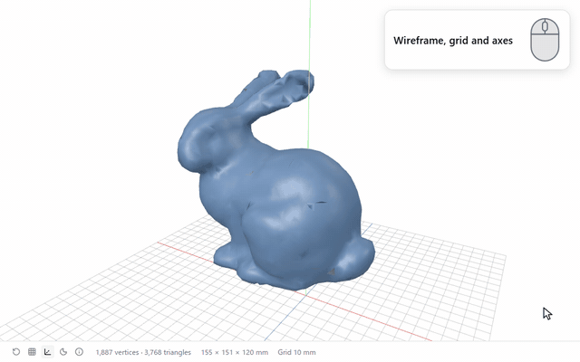
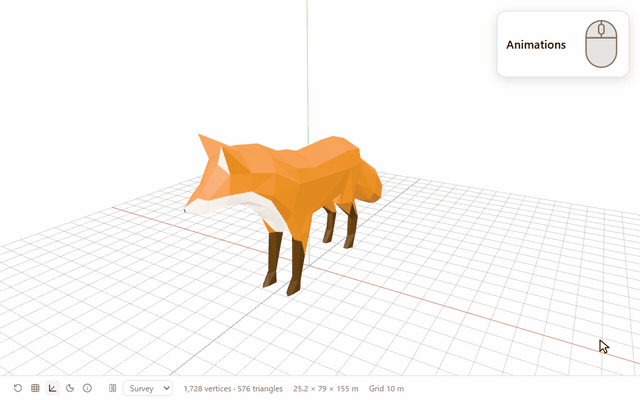

<div align="center">

[English](../../README.md) · [日本語](README.ja.md) · [Deutsch](README.de.md) · **Español** ·
[Français](README.fr.md) · [한국어](README.ko.md) · [Português](README.pt-BR.md) ·
[Русский](README.ru.md) · [Türkçe](README.tr.md) · [简体中文](README.zh-Hans.md) ·
[繁體中文](README.zh-Hant.md)

# 3D Viewer for Orca

Un visor de solo lectura para [Orca](https://github.com/stablyai/orca) compatible con GLB, glTF, STL, PLY, OBJ, FBX y USD.
Gira la cámara alrededor del modelo, reproduce sus animaciones y comprueba de un vistazo si sus medidas son las que esperas.

[](https://github.com/momokun7/orca-3d-viewer/actions/workflows/ci.yml)
[](../../LICENSE)
[](https://github.com/stablyai/orca)
[](#seguridad)

[Inicio rápido](#inicio-rápido) · [Formatos](#formatos) · [Funciones](#funciones) · [Instalación](#instalación) · [Uso](#uso) ·
[Solución de problemas](#solución-de-problemas) · [Seguridad](#seguridad) · [Desarrollo](#desarrollo) ·
[Informar de un error](https://github.com/momokun7/orca-3d-viewer/issues/new?template=bug_report.yml)



</div>

## Inicio rápido

1. En Orca, abre **Ajustes → Plugins**, busca **3D Viewer**, elige **Revisar e instalar** y luego instálalo y actívalo. El botón **Open in Orca** de la [página del plugin](https://www.onorca.dev/plugins/momokun7/orca-3d-viewer) también lo abre.
2. Abre un archivo `.glb`, `.gltf`, `.stl`, `.ply`, `.obj`, `.fbx`, `.usdz`, `.usda`, `.usdc` o `.usd`.
3. Arrastra para girar el modelo y usa la rueda del ratón para acercarlo o alejarlo.

No requiere ningún permiso. Encontrarás más información en [Instalación](#instalación) y [Uso](#uso).

## Formatos

Un solo visor para siete formatos.

<table>
  <tr>
    <td width="33%"></td>
    <td width="33%"></td>
    <td width="33%"></td>
  </tr>
  <tr>
    <td align="center"><b>GLB</b>: A Beautiful Game</td>
    <td align="center"><b>glTF</b>: Corset</td>
    <td align="center"><b>STL</b>: 3DBenchy</td>
  </tr>
  <tr>
    <td width="33%"></td>
    <td width="33%"></td>
    <td width="33%"></td>
  </tr>
  <tr>
    <td align="center"><b>PLY</b>: Stanford Armadillo</td>
    <td align="center"><b>OBJ</b>: Utah Teapot</td>
    <td align="center"><b>FBX</b>: BoomBox</td>
  </tr>
  <tr>
    <td width="33%"></td>
    <td width="33%"></td>
    <td width="33%"></td>
  </tr>
  <tr>
    <td align="center"><b>USD</b>: WaterBottle</td>
    <td></td>
    <td></td>
  </tr>
</table>

| Formato | Extensiones | Colores y texturas | Animación | Unidad de medida | Notas |
| --- | --- | --- | --- | --- | --- |
| glTF 2.0 | `.glb` `.gltf` | Sí | Sí | Metros (según la especificación de glTF) | Un `.gltf` debe llevar los datos incrustados |
| STL | `.stl` | Los colores guardados en el archivo o, si no hay, uno predeterminado | No | Milímetros (lo habitual en impresión 3D), con Z hacia arriba | Binario y texto |
| PLY | `.ply` | Colores de vértice o, si no hay, uno predeterminado | No | Se interpreta en metros | Binario y texto |
| OBJ | `.obj` | Colores de vértice (el `.mtl` no se puede leer) | No | Se interpreta en metros | |
| FBX | `.fbx` | Solo texturas incrustadas | Sí | La que indica el archivo | FBX binario 7.0 (2011) o posterior |
| USD | `.usdz` `.usda` `.usdc` `.usd` | Solo las texturas incluidas en el `.usdz` | Sí | La que indica el archivo (centímetros si no indica ninguna) | Texto (USDA) y binario (USDC). El `.usdz` debe estar sin comprimir, como exige USDZ |

También admite glTF comprimido con Draco o Meshopt y texturas KTX2 / Basis Universal.

## Funciones

### Mirar alrededor

<table>
  <tr>
    <td width="50%"></td>
    <td width="50%"></td>
  </tr>
  <tr>
    <td align="center"><b>Girar</b>: arrastrar</td>
    <td align="center"><b>Desplazar</b>: arrastrar con el botón derecho, o <kbd>Shift</kbd> + arrastrar</td>
  </tr>
  <tr>
    <td width="50%"></td>
    <td width="50%"></td>
  </tr>
  <tr>
    <td align="center"><b>Zoom</b>: rueda del ratón</td>
    <td align="center"><b>Restablecer vista</b>: el primer botón de la barra de herramientas</td>
  </tr>
</table>

### Tamaño real

Una cuadrícula, los ejes X / Y / Z y las medidas del modelo (ancho × alto × profundidad) hacen que salte a la vista
cualquier modelo creado con la unidad equivocada. El Stanford Bunny, por ejemplo, mide 15,6 cm de ancho.


### Alambre, cuadrícula y ejes

Muestra la malla solo con sus aristas, u oculta la cuadrícula y los ejes. La barra de estado indica cuántos vértices y triángulos tiene el modelo.



### Animaciones

Reproduce o pausa la animación y, si el modelo tiene varios clips, elige cuál ver.



### Siempre al día

Cada vez que guardas el archivo, la vista se actualiza con la nueva versión sin mover la cámara.


### Claro u oscuro

El visor se abre con el tema claro; el botón de la luna de la barra de herramientas activa y desactiva el **Tema oscuro**.
Recuerda el tema, el modo alambre y la cuadrícula que elegiste la última vez, incluso al reiniciar Orca (requiere Orca 1.4.250 o posterior).


### Once idiomas

El visor se muestra en el mismo idioma que Orca: English, 日本語, Deutsch, Español, Français, 한국어, Português,
Русский, Türkçe, 简体中文 y 繁體中文.

### Detalles para adjuntar a un issue

El botón **i** de la barra de herramientas (o, en una pantalla de error, el botón **Detalles** que aparece bajo el mensaje) abre un resumen
con la versión del visor, tu navegador y tu GPU, las últimas cargas y lo que tardó cada una, y los errores que se hayan producido.
Pulsa **Copiar** y pégalo en un issue: con eso basta para saber qué pasó. No incluye datos del modelo, salvo lo que cite algún mensaje de error.


## Instalación

3D Viewer aparece en el catálogo de plugins de la comunidad de Orca. Si lo instalas desde el catálogo, se actualiza solo cuando sale una versión nueva.

1. En Orca, abre **Ajustes → Plugins** y busca **3D Viewer**.
   **Open in Orca** en la [página del plugin](https://www.onorca.dev/plugins/momokun7/orca-3d-viewer) abre la misma página.
2. Elige **Revisar e instalar**, comprueba a qué puede acceder y luego instálalo y actívalo. El visor no pide ningún permiso.

Si 3D Viewer no aparece, añade el catálogo de la comunidad en **Añadir plugin → Fuentes del catálogo…** con la URL `https://github.com/stablyai/orca-community-plugins.git` y la ref `main`.

<details>
<summary>Instalar desde una URL de Git</summary>

1. Abre **Ajustes → Plugins → Instalar plugin** y, en la pestaña **Git URL**, pega esta dirección en **URL del repositorio**:

   ```text
   https://github.com/momokun7/orca-3d-viewer#v1.0.2
   ```

2. Elige **Continuar**, luego **Instalar** y, en el cuadro de diálogo que aparece, **Activar plugin**.

Instalado de esta forma, el plugin no se actualiza solo.

</details>

> [!IMPORTANT]
> Requiere la aplicación de escritorio de Orca, versión 1.4.248 o posterior.

## Uso

Abre un archivo en cualquiera de estos formatos y se mostrará en 3D. Como `.gltf` y `.obj` son archivos de texto, la
pestaña del editor te deja alternar entre **Código fuente** (el texto) y **3D**.

| Acción | Cómo |
| --- | --- |
| Girar | Arrastrar |
| Desplazar | Arrastrar con el botón derecho, <kbd>Shift</kbd> + arrastrar, o las teclas de flecha |
| Zoom | Rueda del ratón |
| Restablecer vista | El primer botón de la barra de herramientas |
| Alambre, cuadrícula y ejes | Los botones que le siguen |
| Claro u oscuro | El botón de la luna |
| Detalles | El botón **i** |
| Animaciones | El botón de reproducción y el menú de clips, si el modelo tiene animaciones |

## Límites

> [!NOTE]
> Los plugins de Orca solo pueden leer el archivo abierto, no el resto de archivos de la carpeta, así que no es posible
> mostrar datos que estén en archivos aparte. Un `.gltf` con la geometría en un `.bin` independiente no se abre, y las
> texturas en archivos de imagen independientes y el `.mtl` de un OBJ se ignoran. En cambio, un `.glb`, un `.gltf` con los
> datos incrustados o un FBX con las texturas incrustadas se muestran por completo. Tampoco se muestran las partes que una capa USD trae de otros archivos USD; un `.usdz` que lo reúne todo en un solo archivo se muestra por completo.

- **Solo en la aplicación de escritorio.** Si usas Orca desde un navegador, el archivo se abre en Código fuente.
- **Hasta 64 MiB**, el límite de Orca para editores personalizados. Si un modelo ocuparía, una vez decodificado, mucho más de
  lo que se puede manejar con seguridad, o usa algo que el visor no sabe leer, se rechaza con un mensaje que explica el motivo.
- **No admite FBX antiguos ni de texto.** Vuelve a exportarlos como FBX binario 7.0 o posterior.

Se han probado los 152 modelos GLB y glTF con datos incrustados de los
[glTF Sample Assets](https://github.com/KhronosGroup/glTF-Sample-Assets) de Khronos: se abren todos menos
tres, que necesitan una extensión que three.js no implementa.

## Solución de problemas

<details>
<summary>El archivo se abre como texto y no en 3D</summary>

Como `.gltf` y `.obj` son archivos de texto, pueden abrirse en Código fuente (el texto). Elige **3D** en la pestaña del editor. Si
usas Orca desde un navegador, la vista 3D no está disponible.

</details>

<details>
<summary>Faltan texturas o colores</summary>

Los plugins no pueden leer texturas guardadas en archivos de imagen independientes; la barra de estado indica qué archivos no se pudieron leer.
En glTF, usa un `.glb`; en FBX, exporta con las texturas incrustadas; en USD, exporta un `.usdz` que incluya las texturas. Como el `.mtl` de un OBJ no se puede leer, el modelo se muestra
con sus colores de vértice si los tiene, o con un color predeterminado si no.

</details>

<details>
<summary>El tamaño no parece correcto</summary>

STL se muestra en milímetros, y PLY y OBJ en metros, porque ninguno de estos formatos guarda la unidad. FBX y glTF usan la
unidad que indica el archivo. USD usa la unidad que indica el archivo (`metersPerUnit`); si no indica ninguna, el modelo se interpreta en centímetros, como establece USD, y la barra de estado lo avisa. Si el tamaño no cuadra por un factor de 1000 o de 100, revisa la unidad con la que se exportó el modelo.

</details>

<details>
<summary>Aparece un mensaje de que el modelo no se puede abrir</summary>

El propio mensaje explica el motivo. Los modelos demasiado grandes, los archivos dañados y los que usan funciones que el visor no
admite se rechazan antes de abrirlos. Si el motivo no queda claro, copia los **Detalles** en un issue.

</details>

<details>
<summary>Informar de un error</summary>

Usa la plantilla de [informe de error](https://github.com/momokun7/orca-3d-viewer/issues/new?template=bug_report.yml)
y pega el texto de **Detalles**. Si puedes compartir el modelo, indica de dónde lo sacaste. Los problemas de seguridad se comunican
mediante un [informe privado](https://github.com/momokun7/orca-3d-viewer/security/advisories/new), no en un issue.

</details>

## Seguridad

Un modelo es una entrada que no es de fiar, así que el visor está pensado para ofrecer al atacante lo menos posible.

- **Aislado**: se ejecuta en el marco aislado que Orca reserva a los plugins, con una Content-Security-Policy estricta y sin acceso a la red.
- **Sin permisos**: el manifiesto no solicita ninguna capacidad; ni workers, ni comandos, ni acceso a archivos.
- **Solo lectura**: nunca modifica ni guarda el documento, y las URI que contenga un modelo nunca llegan a ningún cargador.
- **Comprobación previa**: antes de decodificar nada, cada formato se contrasta con unos límites de tamaño en un hilo
  aparte. Los arrays comprimidos de FBX se descomprimen poco a poco, y el proceso se detiene en cuanto superan el tamaño declarado. Las capas USD binarias (USDC) se leen por etapas: antes de cada una se estiman, a partir del archivo, la memoria y el trabajo que requiere, y un archivo que supera los límites se rechaza antes de leerlo.
- **Probado**: la CI ejecuta el visor con la política de marcos de Orca frente a modelos maliciosos y generados mediante fuzzing, y comprueba
  que el bundle incluido en el repositorio se puede reproducir a partir del código fuente.

Encontrarás todos los detalles en [SECURITY.md](../../SECURITY.md).

## Desarrollo

El código del plugin está en `build/src`. `build/build.mjs` lo empaqueta en `editor/`, que se incluye en el repositorio para que Orca
pueda cargar el plugin sin necesidad de compilarlo.

```sh
cd build
npm ci
npm test
npm run typecheck
npm run build
```

Con [mise](https://mise.jdx.dev), `mise run check` ejecuta todo lo que ejecuta la CI, y `mise tasks` muestra el resto de tareas.

Para probar tus cambios en Orca, ejecuta `orca plugin dev watch .` desde la raíz del repositorio o añade la carpeta en
**Ajustes → Plugins → Desarrollo**.

## Contribuir

En [CONTRIBUTING.md](../../CONTRIBUTING.md) se explica cómo funcionan los issues, las etiquetas, el tablero del proyecto,
los hitos y los pull requests. Todas las traducciones, salvo la inglesa y la japonesa, se hicieron con traducción automática;
agradeceremos mucho las correcciones de hablantes nativos.

## Licencia y créditos

[MIT](../../LICENSE). Los componentes incluidos en el paquete (three.js, meshoptimizer, fflate y Lucide, con licencia MIT / ISC,
y el decodificador Draco, con licencia Apache-2.0) mantienen sus propias licencias; consulta [THIRD_PARTY_NOTICES.txt](../../THIRD_PARTY_NOTICES.txt).

Los modelos que aparecen en las imágenes y los GIF, en el icono del plugin y en las imágenes de la página del plugin en Orca proceden de las fuentes que se indican abajo. En todos ellos, la conversión de formato,
los colores (los de 3DBenchy, el Armadillo y la tetera los añadimos nosotros al archivo) y la orientación son modificaciones nuestras.

| Modelo | Dónde aparece | Fuente | Licencia |
| --- | --- | --- | --- |
| Stanford Bunny | Imagen principal, GIF de funciones, icono del plugin, página del plugin | [Stanford 3D Scanning Repository](https://graphics.stanford.edu/data/3Dscanrep/). Source: Stanford University Computer Graphics Laboratory | Uso no comercial libre, citando la fuente |
| Stanford Armadillo | PLY | Igual que el anterior | Igual que el anterior |
| A Beautiful Game | GLB, página del plugin | Khronos [glTF Sample Assets](https://github.com/KhronosGroup/glTF-Sample-Assets). Modelo original del MaterialX Project, convertido a glTF por Ed Mackey | [CC BY 4.0](https://creativecommons.org/licenses/by/4.0/) |
| Corset | glTF | Khronos glTF Sample Assets, Microsoft | [CC0 1.0](https://creativecommons.org/publicdomain/zero/1.0/) |
| BoomBox | FBX, página del plugin | Khronos glTF Sample Assets, Microsoft | CC0 1.0 |
| 3DBenchy | STL | [3DBenchy.com](https://www.3dbenchy.com/), Creative Tools | CC0 1.0 |
| Utah Teapot | OBJ | [McGuire Computer Graphics Archive](https://casual-effects.com/data), Martin Newell (1975), Kenzie Lamar | CC0 |
| WaterBottle | USD | Khronos glTF Sample Assets, Microsoft | CC0 1.0 |
| Fox | GIF de animación, página del plugin | Khronos glTF Sample Assets. Modelo de PixelMannen (CC0 1.0), rigging y animación de tomkranis, convertido a glTF por @AsoboStudio y @scurest | [CC BY 4.0](https://creativecommons.org/licenses/by/4.0/) |
