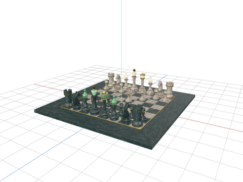
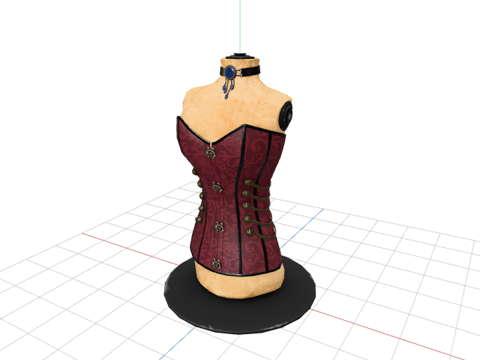
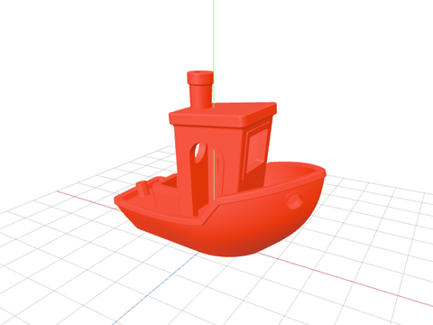
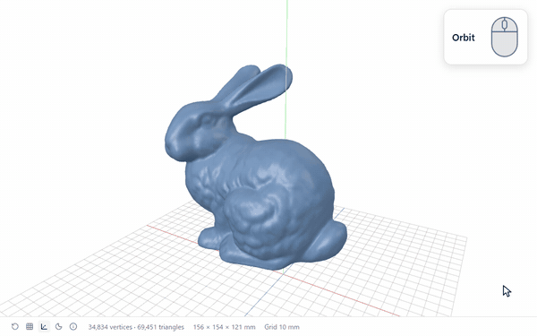
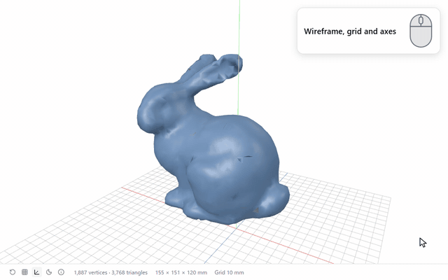

<div align="center">

[English](../../README.md) · [日本語](README.ja.md) · [Deutsch](README.de.md) · [Español](README.es.md) ·
[Français](README.fr.md) · [한국어](README.ko.md) · [Português](README.pt-BR.md) ·
**Русский** · [Türkçe](README.tr.md) · [简体中文](README.zh-Hans.md) ·
[繁體中文](README.zh-Hant.md)

# 3D Viewer for Orca

Средство просмотра для [Orca](https://github.com/stablyai/orca): открывает GLB, glTF, STL, PLY, OBJ и FBX, ничего в них не меняя.
Вращайте камеру вокруг модели, запускайте её анимации и сразу проверяйте, тот ли у неё размер, на который вы рассчитывали.

[](https://github.com/momokun7/orca-3d-viewer/actions/workflows/ci.yml)
[](../../LICENSE)
[](https://github.com/stablyai/orca)
[](#безопасность)

[Быстрый старт](#быстрый-старт) · [Форматы](#форматы) · [Возможности](#возможности) · [Установка](#установка) · [Использование](#использование) ·
[Устранение неполадок](#устранение-неполадок) · [Безопасность](#безопасность) · [Разработка](#разработка) ·
[Сообщить об ошибке](https://github.com/momokun7/orca-3d-viewer/issues/new?template=bug_report.yml)


</div>

## Быстрый старт

1. В Orca откройте **Настройки → Плагины → Установить плагин**, на вкладке **URL Git** вставьте `https://github.com/momokun7/orca-3d-viewer#v1.0.1`, нажмите **Продолжить**, затем **Установить** и в появившемся окне — **Включить плагин**.
2. Откройте файл `.glb`, `.gltf`, `.stl`, `.ply`, `.obj` или `.fbx`.
3. Перетаскивайте модель мышью, чтобы повернуть её, и крутите колёсико, чтобы изменить масштаб.

Разрешения не нужны. Подробнее — в разделах [Установка](#установка) и [Использование](#использование).

## Форматы

Шесть форматов в одном средстве просмотра.

<table>
  <tr>
    <td width="33%"></td>
    <td width="33%"></td>
    <td width="33%"></td>
  </tr>
  <tr>
    <td align="center"><b>GLB</b>: A Beautiful Game</td>
    <td align="center"><b>glTF</b>: Corset</td>
    <td align="center"><b>STL</b>: 3DBenchy</td>
  </tr>
  <tr>
    <td width="33%"></td>
    <td width="33%"></td>
    <td width="33%"></td>
  </tr>
  <tr>
    <td align="center"><b>PLY</b>: Stanford Armadillo</td>
    <td align="center"><b>OBJ</b>: Utah Teapot</td>
    <td align="center"><b>FBX</b>: BoomBox</td>
  </tr>
</table>

| Формат | Расширения | Цвета и текстуры | Анимация | Единицы размера | Примечания |
| --- | --- | --- | --- | --- | --- |
| glTF 2.0 | `.glb` `.gltf` | Да | Да | Метры (по спецификации glTF) | Данные `.gltf` должны быть встроены в файл |
| STL | `.stl` | Цвета из файла, если они есть, иначе цвет по умолчанию | Нет | Миллиметры (как принято в 3D-печати), ось Z направлена вверх | Двоичный и текстовый |
| PLY | `.ply` | Цвета вершин, если они есть, иначе цвет по умолчанию | Нет | Считаются метрами | Двоичный и текстовый |
| OBJ | `.obj` | Цвета вершин (`.mtl` не читается) | Нет | Считаются метрами | |
| FBX | `.fbx` | Только встроенные текстуры | Да | Указанные в файле | Двоичный FBX 7.0 (2011) и новее |

Поддерживаются и glTF со сжатием Draco или Meshopt, и текстуры KTX2 / Basis Universal.

## Возможности

### Осмотр модели

<table>
  <tr>
    <td width="50%"></td>
    <td width="50%"></td>
  </tr>
  <tr>
    <td align="center"><b>Вращение</b>: перетаскивание</td>
    <td align="center"><b>Сдвиг</b>: перетаскивание правой кнопкой или <kbd>Shift</kbd> + перетаскивание</td>
  </tr>
  <tr>
    <td width="50%"></td>
    <td width="50%"></td>
  </tr>
  <tr>
    <td align="center"><b>Масштаб</b>: колёсико</td>
    <td align="center"><b>Сбросить вид</b>: первая кнопка на панели инструментов</td>
  </tr>
</table>

### Реальный размер

Сетка пола, оси X / Y / Z и габариты модели (ширина × высота × глубина): если модель сделана не в тех единицах,
это сразу бросается в глаза. Например, ширина стэнфордского кролика — 15,6 см.


### Каркас, сетка и оси

Меш можно показать одними линиями, а сетку и оси — скрыть. Число вершин и треугольников выводится в строке
состояния.



### Анимации

Анимацию можно запустить и поставить на паузу, а если у модели несколько клипов — выбрать нужный.


### Всегда актуально

Сохраните файл — и на экране появится новая версия, а камера останется там, где была.


### Светлая или тёмная тема

По умолчанию включена светлая тема; кнопка с луной на панели инструментов переключает её на тёмную и обратно.
Выбранные тема, каркас и сетка сохраняются и после перезапуска Orca (в Orca 1.4.250 и новее).


### Одиннадцать языков

Интерфейс средства просмотра выводится на том же языке, что и Orca: English, 日本語, Deutsch, Español, Français, 한국어, Português,
Русский, Türkçe, 简体中文 и 繁體中文.

### Подробности для issue

Кнопка **i** на панели инструментов (а на экране ошибки — кнопка **Подробности** под сообщением) открывает сводку:
версия средства просмотра, ваш браузер и графика, последние загрузки с их длительностью и возникшие ошибки.
Нажмите **Копировать** и вставьте текст в issue — по нему будет понятно, что произошло. Данных модели в сводке нет, кроме фрагментов, процитированных в сообщениях об ошибках.


## Установка

1. В Orca откройте **Настройки → Плагины** и нажмите **Установить плагин**.
2. На вкладке **URL Git** вставьте в поле **URL репозитория с #ref**:

   ```text
   https://github.com/momokun7/orca-3d-viewer#v1.0.1
   ```

3. Нажмите **Продолжить**, затем **Установить**. В появившемся окне нажмите **Включить плагин** — пока вы этого
   не сделаете, код плагина не запускается. Средство просмотра не запрашивает разрешений, так что больше ничего
   разрешать не нужно.

> [!IMPORTANT]
> Требуется настольное приложение Orca версии 1.4.248 или новее.

## Использование

Откройте файл любого из этих форматов — и он отобразится в 3D. `.gltf` и `.obj` — текстовые файлы, поэтому на вкладке
редактора их можно переключать между режимами **Исходный текст** и **3D**.

| Действие | Способ |
| --- | --- |
| Вращение | Перетаскивание |
| Сдвиг | Перетаскивание правой кнопкой, <kbd>Shift</kbd> + перетаскивание или клавиши со стрелками |
| Масштаб | Колёсико |
| Сбросить вид | Первая кнопка на панели инструментов |
| Каркас, сетка и оси | Кнопки рядом с ней |
| Светлая или тёмная тема | Кнопка с луной |
| Подробности | Кнопка **i** |
| Анимации | Кнопка воспроизведения и меню клипов (если у модели есть анимации) |

## Ограничения

> [!NOTE]
> Плагинам Orca доступен только открытый файл, но не соседние файлы в той же папке, поэтому всё, что хранится
> отдельно, показать нельзя. `.gltf`, геометрия которого лежит в отдельном `.bin`, не откроется, а текстуры
> из отдельных файлов изображений и `.mtl` для OBJ не подгрузятся. Файлы `.glb`, `.gltf` со встроенными данными
> и FBX со встроенными текстурами отображаются целиком.

- **Только настольное приложение.** В браузерной версии Orca файл открывается как исходный текст.
- **До 64 MiB** — таково ограничение Orca для пользовательских редакторов. Если после распаковки модель заняла бы
  в памяти намного больше безопасного или в ней есть то, что средство просмотра не умеет читать, она не откроется,
  а в сообщении будет указана причина.
- **Старые и текстовые FBX не поддерживаются.** Экспортируйте файл заново в двоичный FBX 7.0 или новее.

Мы проверили все 152 модели GLB и glTF со встроенными данными из набора Khronos
[glTF Sample Assets](https://github.com/KhronosGroup/glTF-Sample-Assets): открываются все, кроме трёх —
им нужно расширение, которого нет в three.js.

## Устранение неполадок

<details>
<summary>Файл открывается как текст, а не в 3D</summary>

`.gltf` и `.obj` — текстовые файлы, поэтому они могут открыться как исходный текст. Переключите вкладку
редактора в режим **3D**. В браузерной версии Orca режим 3D недоступен.

</details>

<details>
<summary>Нет текстур или цветов</summary>

Плагин не может прочитать текстуры из отдельных файлов изображений; файлы, которые не удалось прочитать,
перечислены в строке состояния. Для glTF используйте `.glb`, а FBX экспортируйте со встроенными текстурами.
`.mtl` для OBJ не читается, поэтому модель окрашивается в цвета вершин, а если их нет — в цвет по умолчанию.

</details>

<details>
<summary>Размер выглядит неправильно</summary>

STL показывается в миллиметрах, а PLY и OBJ — в метрах: эти форматы не хранят единицы измерения. Для FBX и glTF
берутся единицы, указанные в файле. Если размер расходится в 1000 или 100 раз, проверьте, в каких единицах
экспортировалась модель.

</details>

<details>
<summary>Появляется сообщение, что модель нельзя открыть</summary>

Причина указана в самом сообщении. Слишком большие модели, повреждённые файлы и модели с возможностями, которые
средство просмотра не поддерживает, отсекаются ещё до открытия. Если причина непонятна, скопируйте **Подробности**
в issue.

</details>

<details>
<summary>Как сообщить об ошибке</summary>

Используйте шаблон [сообщения об ошибке](https://github.com/momokun7/orca-3d-viewer/issues/new?template=bug_report.yml)
и вставьте в него текст из панели **Подробности**. Если можете поделиться моделью, укажите, откуда она взята. О проблемах
безопасности сообщайте не в issue, а через [закрытый отчёт](https://github.com/momokun7/orca-3d-viewer/security/advisories/new).

</details>

## Безопасность

Любая модель — это непроверенные входные данные, поэтому средство просмотра устроено так, чтобы атаковать его было неинтересно.

- **Изоляция**: средство просмотра работает в изолированном фрейме плагинов Orca со строгой Content-Security-Policy
  и без доступа к сети.
- **Без разрешений**: манифест не запрашивает никаких возможностей — ни worker, ни команд, ни доступа к файлам.
- **Только чтение**: документ никогда не изменяется и не сохраняется, а URI из модели никогда не передаются
  загрузчику.
- **Сначала проверка**: файл любого формата сверяется с ограничениями по размеру в отдельном потоке ещё до того,
  как что-либо будет декодировано. Сжатые массивы FBX распаковываются небольшими порциями, и распаковка
  прекращается, как только превышен заявленный размер.
- **Тесты**: CI прогоняет средство просмотра с политикой фрейма Orca на вредоносных и фаззинговых моделях
  и проверяет, что закоммиченный бандл воспроизводимо собирается из исходного кода.

Подробности — в [SECURITY.md](../../SECURITY.md).

## Разработка

Код плагина лежит в `build/src`. `build/build.mjs` собирает его в папку `editor/`; она хранится в репозитории,
чтобы Orca могла загружать плагин без отдельной сборки.

```sh
cd build
npm ci
npm test
npm run typecheck
npm run build
```

Если у вас есть [mise](https://mise.jdx.dev), команда `mise run check` выполняет те же проверки, что и CI, а `mise tasks`
выводит список остальных задач.

Чтобы опробовать изменения в Orca, выполните `orca plugin dev watch .` в корне репозитория или добавьте папку
в разделе **Настройки → Плагины → Разработка**.

## Участие в проекте

Как устроены issues, метки, доска проекта, вехи и pull requests, описано в [CONTRIBUTING.md](../../CONTRIBUTING.md).
Все версии, кроме английской и японской, изначально переведены машинным способом; будем рады правкам от носителей языка.

## Лицензия и источники

[MIT](../../LICENSE). Включённые в сборку three.js, meshoptimizer, fflate и Lucide (MIT / ISC), а также декодер Draco
(Apache-2.0) распространяются под собственными лицензиями; см. [THIRD_PARTY_NOTICES.txt](../../THIRD_PARTY_NOTICES.txt).

Модели на изображениях и в GIF, на значке плагина и на изображениях страницы плагина в Orca взяты из перечисленных ниже источников. Во всех копиях мы изменили формат, цвета
(у 3DBenchy, броненосца и чайника цвета записали в файл мы) и ориентацию.

| Модель | Где используется | Источник | Лицензия |
| --- | --- | --- | --- |
| Stanford Bunny | Главное изображение, GIF в разделе «Возможности», значок плагина, страница плагина | [Stanford 3D Scanning Repository](https://graphics.stanford.edu/data/3Dscanrep/). Source: Stanford University Computer Graphics Laboratory | Бесплатно для некоммерческого использования с указанием авторства |
| Stanford Armadillo | PLY | То же | То же |
| A Beautiful Game | GLB, страница плагина | Khronos [glTF Sample Assets](https://github.com/KhronosGroup/glTF-Sample-Assets). Исходная модель — MaterialX Project, преобразование в glTF — Ed Mackey | [CC BY 4.0](https://creativecommons.org/licenses/by/4.0/) |
| Corset | glTF | Khronos glTF Sample Assets, Microsoft | [CC0 1.0](https://creativecommons.org/publicdomain/zero/1.0/) |
| BoomBox | FBX, страница плагина | Khronos glTF Sample Assets, Microsoft | CC0 1.0 |
| 3DBenchy | STL | [3DBenchy.com](https://www.3dbenchy.com/), Creative Tools | CC0 1.0 |
| Utah Teapot | OBJ | [McGuire Computer Graphics Archive](https://casual-effects.com/data), Martin Newell (1975), Kenzie Lamar | CC0 |
| Fox | GIF в разделе «Анимации», страница плагина | Khronos glTF Sample Assets. Модель — PixelMannen (CC0 1.0), риггинг и анимация — tomkranis, преобразование в glTF — @AsoboStudio и @scurest | [CC BY 4.0](https://creativecommons.org/licenses/by/4.0/) |
